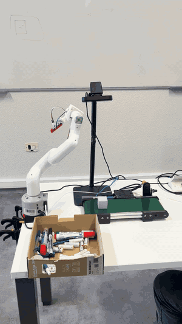

# BeltBot

**Vision-guided pick and place with a myCobot 280 M5, an Arduino conveyor belt and OpenCV.**

A camera watches the conveyor belt. When a piece arrives, the belt stops, the robot arm picks the piece and drops it in a box, and the belt starts again. Everything is coordinated from Python with object-oriented code.

<p align="center">
  
</p>

## How it works

```
Camera ──> PieceDetector ──> piece in the zone? ──> Conveyor.stop()
                                                  ├─> Arm picks the piece and drops it in the box
                                                  └─> Conveyor.start()
```

1. The conveyor runs and the camera watches a zone at the end of the belt (the **ROI**).
2. At the start, the program takes a reference image of the **empty** belt.
3. Every frame, the zone is compared with the reference. When enough pixels change, a piece has arrived.
4. The belt keeps moving a fraction of a second more, so the piece stops in the centre, and then stops.
5. The robot goes above the piece, goes down, closes the gripper, takes it to the box and comes back home.
6. The belt starts again and waits for the next piece.

The Arduino only **obeys commands**. All the decisions are taken in Python.

## Hardware

| Part | Use |
|---|---|
| myCobot 280 M5 (Elephant Robotics) + adaptive gripper | picks and places the pieces |
| Conveyor belt with 12 V DC motor | moves the pieces |
| Arduino UNO + motor driver | controls the belt (speed, direction, start/stop) |
| USB camera on a stand | detects the pieces on the belt |
| PC with Python | runs everything |

## Project structure

```
.
├── src/
│   ├── arm.py               # Arm: control of the real myCobot (angles, gripper)
│   ├── arm_coords.py        # ArmCoords(Arm): extra control by x, y, z coordinates
│   ├── conveyor.py          # Conveyor: sends commands to the Arduino over serial
│   ├── piece_detector.py    # PieceDetector: detects a piece in the ROI with OpenCV
│   ├── record.py            # teach positions by moving the arm by hand
│   ├── play.py              # replay the recorded positions
│   ├── conveyor_camera.py   # belt + camera: the belt stops when a piece arrives
│   ├── pick_and_place.py    # full cell: belt + camera + robot
│   └── positions.json       # recorded positions (joint angles)
├── firmware/
│   └── conveyor_firmware/
│       └── conveyor_firmware.ino   # Arduino firmware of the belt
├── media/
│   └── demo.gif
└── requirements.txt
```

## Main classes

| Class | Responsibility |
|---|---|
| `Arm` | connect to the robot, move by joint angles, open/close the gripper, release/lock the motors |
| `ArmCoords` | inherits from `Arm` and adds movements by coordinates |
| `Conveyor` | start, stop, direction and speed of the belt through the serial port |
| `PieceDetector` | calibrate with the empty belt and tell if there is a piece in the zone |

Positions are saved as **joint angles** (not coordinates), so they can be reused later by a virtual robot.

## Serial protocol (PC ↔ Arduino)

9600 baud, one command per line.

| Command | Reply | Action |
|---|---|---|
| `START` | `OK START` | start the belt |
| `STOP` | `OK STOP` | stop the belt |
| `CW` / `CCW` | `OK CW` / `OK CCW` | change direction |
| `SPEED <0-255>` | `OK SPEED <n>` | change speed |
| `STATUS` | `STATUS ON\|OFF CW\|CCW <speed>` | current state |
| — | `READY` | sent once when the Arduino starts |

Arduino pins: D8 direction, D9 speed (PWM), D10 driver enable.

## Installation

```bash
python -m venv .venv
.venv\Scripts\activate          # Windows
pip install -r requirements.txt
```

Upload `firmware/conveyor_firmware/conveyor_firmware.ino` to the Arduino UNO with the Arduino IDE.

## How to use it

1. **Check the ports** (Arduino IDE → Tools → Port, or Device Manager) and write them in the settings at the top of `src/pick_and_place.py` (`ARM_PORT`, `CONVEYOR_PORT`).
2. **Tune the camera** with `python src/conveyor_camera.py`: choose `CAMERA_INDEX` and the `ROI`, and check that the belt stops when a piece arrives.
3. **Teach the positions** with `python src/record.py`, using these names: `home`, `above_pick`, `pick`, `above_box`, `box`.
4. **Run the full cell:**
   ```bash
   python src/pick_and_place.py
   ```
   Press Enter with the belt empty (calibration) and put pieces on the belt. Press `q` in the camera window to stop.

### Tuning

| Setting | Where | Effect |
|---|---|---|
| `ROI` | `src/pick_and_place.py` | zone of the image where the piece is detected |
| `threshold` | `PieceDetector` | % of changed pixels to say "piece" |
| `EXTRA_TIME` | `src/pick_and_place.py` | seconds the belt keeps moving after the detection |
| `opening` | `Arm.open_gripper()` | how much the gripper opens (0–100) |

## Next steps

- Graphical interface with a **real** mode and a **virtual** mode (MuJoCo simulation).
- Sort the pieces by shape or colour into different boxes.

## Author

**Nidhal Majoul** — Universidad de Burgos.
Developed in extra sessions with Prof. Jaime Andrés Rincón Arango.
